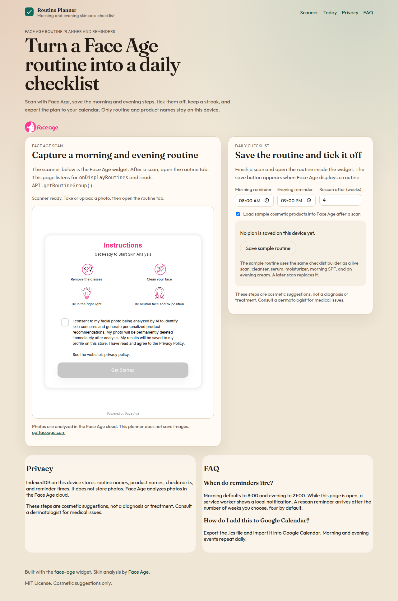
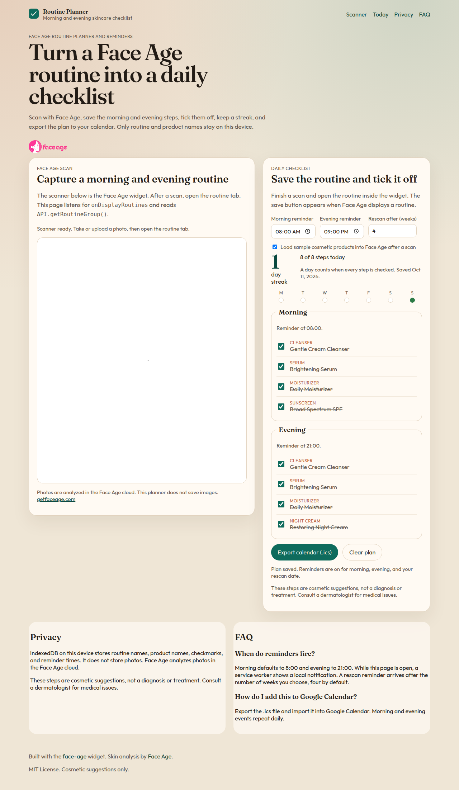

# Face Age Routine Planner and Reminders

Turn a [Face Age](https://getfaceage.com/) morning and evening skincare routine into a daily checklist. Save the steps after a scan, tick them off, keep a streak, get local reminders, and export an `.ics` file for Google Calendar.

This browser app is for people who already receive a cosmetic routine from Face Age and want help sticking to it. It stores routine and product names on the device. It does not store photos.



## Features

- Embeds the [face-age](https://www.npmjs.com/package/face-age) scanner directly on the page and captures the routine with `showRoutine`, `routinesSupport`, `onDisplayRoutines`, and `API.getRoutineGroup()`.
- Optional sample cosmetic catalog through `API.setCustomProducts()`, so a routine can be saved even before a merchant catalog is connected.
- Daily morning and evening checklist stored in IndexedDB.
- Streaks that count a day only when every step is checked.
- Local notifications through a service worker, with a rescan reminder after a configurable number of weeks (default 4).
- `.ics` calendar export for Google Calendar and other calendar apps.
- Privacy-minded storage: names and schedule only, no images.

## How it works

1. Add your Face Age Client ID and open the planner.
2. Scan with the camera or upload a photo. Face Age analyzes the photo in the Face Age cloud and shows a routine.
3. Open the routine tab. The planner listens for `onDisplayRoutines` and reads `API.getRoutineGroup()`.
4. Choose **Save as my plan**. The app asks for notification permission and builds today's checklist.
5. Check off steps each morning and evening. Export an `.ics` file, and come back for a rescan when the reminder arrives.



## Quick start

Requires Node.js 20 or newer.

```bash
git clone https://github.com/miladmostafa/face-age-routine-planner.git
cd face-age-routine-planner
npm install
cp .env.example .env.local
```

### Install the latest face-age package

Before building, install the latest [face-age](https://www.npmjs.com/package/face-age) package in a separate step. The skincare routine planner loads the current Face Age scanner from npm:

```bash
npm install face-age@latest
```

Edit `.env.local` and set `VITE_FACEAGE_CLIENT_ID` to your own Client ID. Then build and start the app:

```bash
npm run build
npm run dev
```

Open the printed local URL. The Face Age widget renders into `#FaceAge-module` on the page.

## Configuration

Create a Client ID at [panel.getfaceage.com](https://panel.getfaceage.com/), then put it in `.env.local`:

```bash
VITE_FACEAGE_CLIENT_ID=your_client_id
```

Restart the dev server after changing the file. If the variable is empty, the scanner stays hidden and the page links to the panel so you can create an ID. The Client ID is never given a default in source code.

| Setting | Default | Where to change it |
| --- | --- | --- |
| Morning reminder | 08:00 | Checklist panel |
| Evening reminder | 21:00 | Checklist panel |
| Rescan reminder | 4 weeks | Checklist panel |
| Sample products | On | "Load sample cosmetic products" |

Sample products are passed to `API.setCustomProducts()` after a scan so the routine tab has named steps. Turn that option off if your Face Age account already supplies the product list through `onDisplayRoutines`.

Routine groups follow the Face Age widget: cleanser, toner, serum, eye cream, spot treatment, moisturizer, sunscreen, face oil, and night cream. Empty groups stay hidden.

## Privacy

- Photos are sent to the Face Age cloud for analysis. This planner does not write images, image URLs, or prices to IndexedDB.
- Saved data is the routine name, product name, checkbox state, reminder times, and rescan interval.
- Reminders are local notifications. They are not a remote push campaign.
- Routines are cosmetic suggestions, not medical advice. Consult a dermatologist for medical issues.

## FAQ

### Is this a medical device?

No. Face Age reports cosmetic signals such as skin age, a skin health or damage percentage, and problem scores. This planner turns the suggested routine into a checklist. It does not diagnose or treat skin conditions.

### Why is the widget an iframe?

The `face-age` package renders its own internal frame (`iframe#FaceAge-module-iframe`) inside `#FaceAge-module`. The app does not wrap the widget in another frame. That internal frame is required for the scanner to run.

### Will reminders fire if the tab is closed?

The service worker shows notifications while the site is open, and it registers periodic background sync when the browser allows it. Desktop browsers often pause background work after the tab closes, so the calendar export is the reliable way to keep 8:00 and evening alarms outside the browser.

### How do I put the routine on Google Calendar?

Choose **Export calendar (.ics)** and import that file into Google Calendar. Morning and evening events repeat daily. A separate event marks the rescan date.

### Which Face Age package is used?

The widget comes from the latest [`face-age`](https://www.npmjs.com/package/face-age) npm release. Before building, install it with the separate command `npm install face-age@latest`.

## Scripts

Run the separate install step, `npm install face-age@latest`, before building.

```bash
npm test
npm run lint
npm run build
npm run dev
```

## License

MIT. See [LICENSE](LICENSE).
